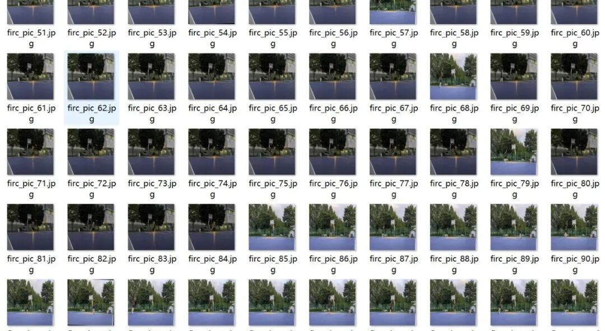
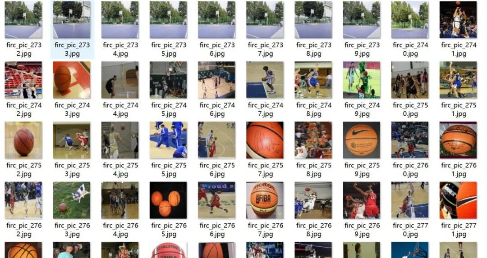
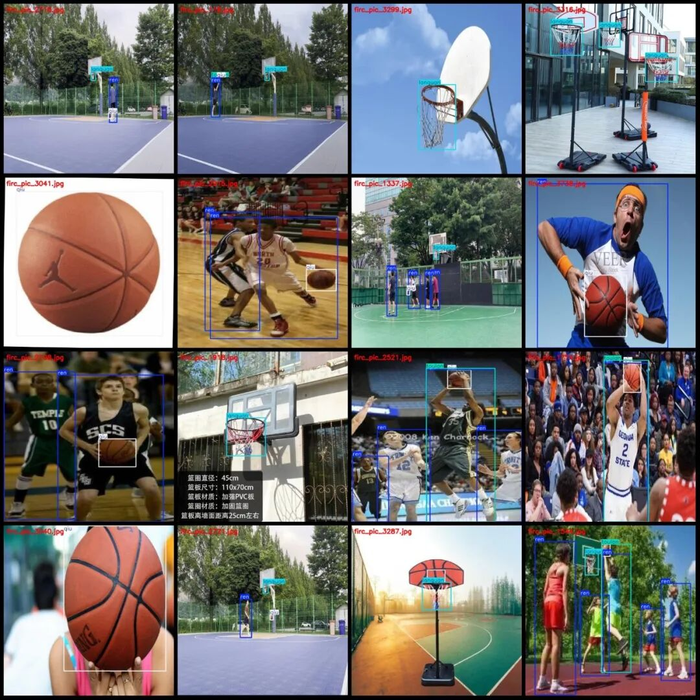
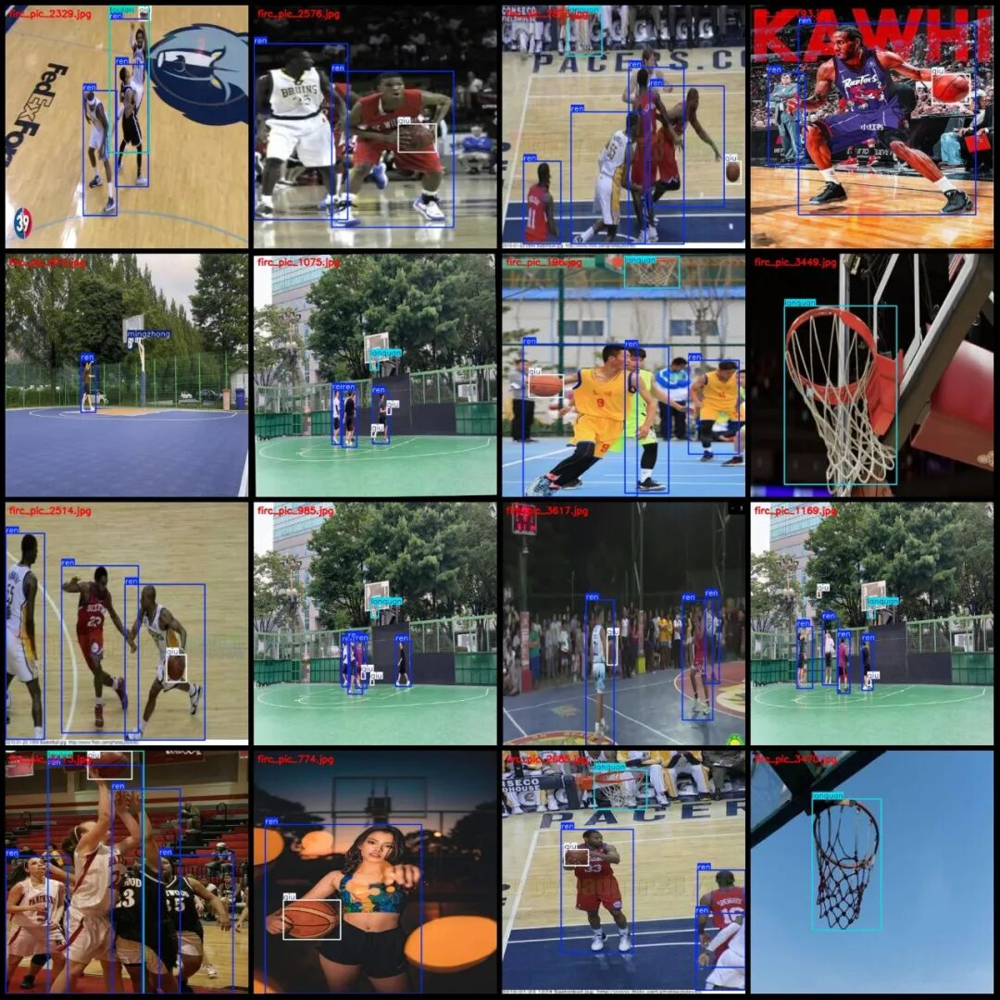
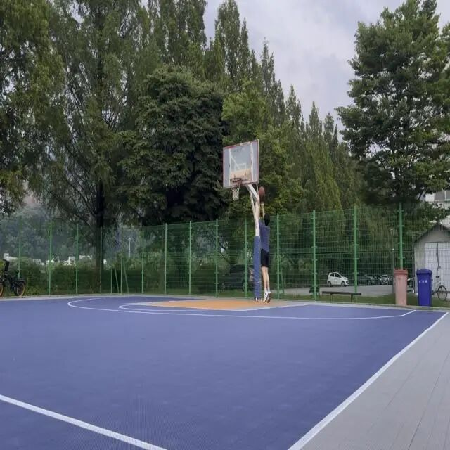
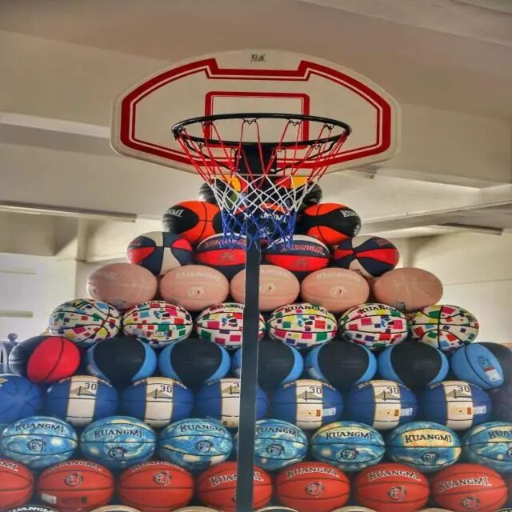
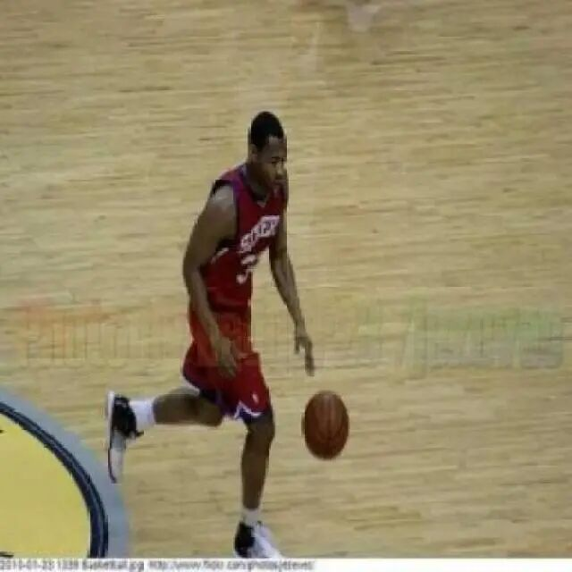

# Basketball Sports Shooting Detection Basketball Elements Dataset VOC+YOLO Format 3832 Images 5 Categories

Dataset format: Pascal VOC format + YOLO format (txt file without split path, only containing jpg images and corresponding VOC format xml files and yolo format txt files)

Number of images (number of jpg files): 3832

Number of XML files: 3832

Number of annotated files (number of txt files): 3832

Label the number of categories: 5

Label category names (Note that the order of labels in the YOLO format does not correspond to this, but is based on the classes.txt file in the labels folder): ["lanquan", "mingzhong", "qiu", "ren", "toulan"]

Corresponding Chinese category names: ["Basket", "Hit", "Ball", "Person", "Shot"]

The number of boxes and the number of images each category is labeled with:

Lanquan frame count = 2552, occupied image count = 2478

Mingzhong Frames = 198, Pictures Taken = 196

The number of qiu frames = 3876, the number of images occupied = 3263

The number of frames = 8463, the number of images occupied = 2702

Toulan Frames = 762, Pictures Taken = 759

Total number of frames: 15851

Image resolution: 640x640

Use labelImg:

Annotation rules: Draw a rectangle around the category.

Important Note: The dataset does not have separate training, validation, and test sets; you will need to partition them yourself.

Special : This dataset does not guarantee the accuracy of the trained models or weight files.

Preview of the image:

Annotation example:

Single image:

## Payment

Here is a pay link on Stripe ( https://buy.stripe.com/3cs8yP7sY87d0vu9AB ). Please contact me lonlonago@foxmail.com after funding $89, and I will send you a complete data files , thank you!

